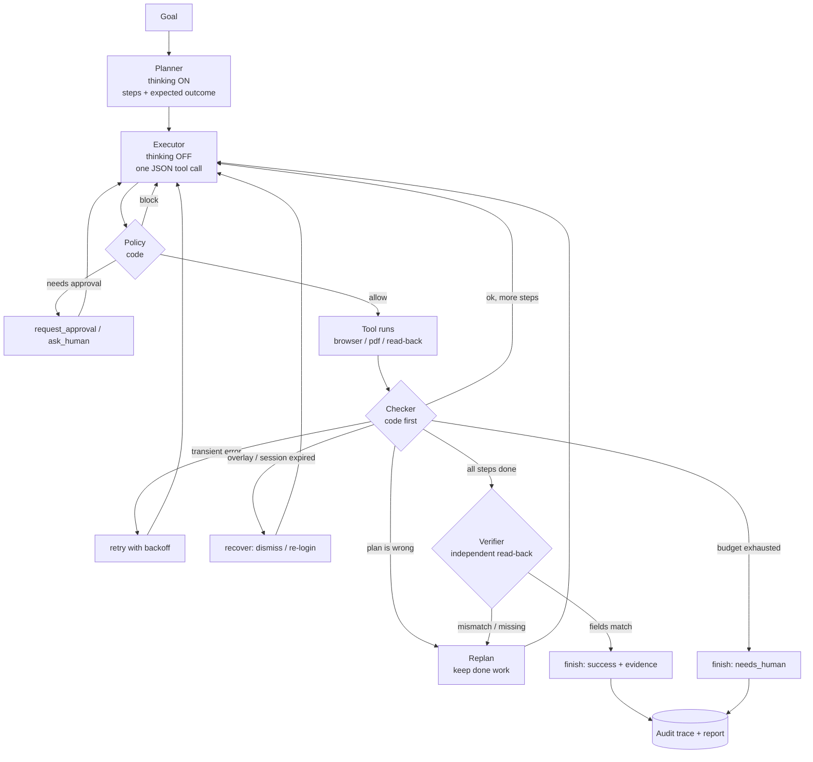
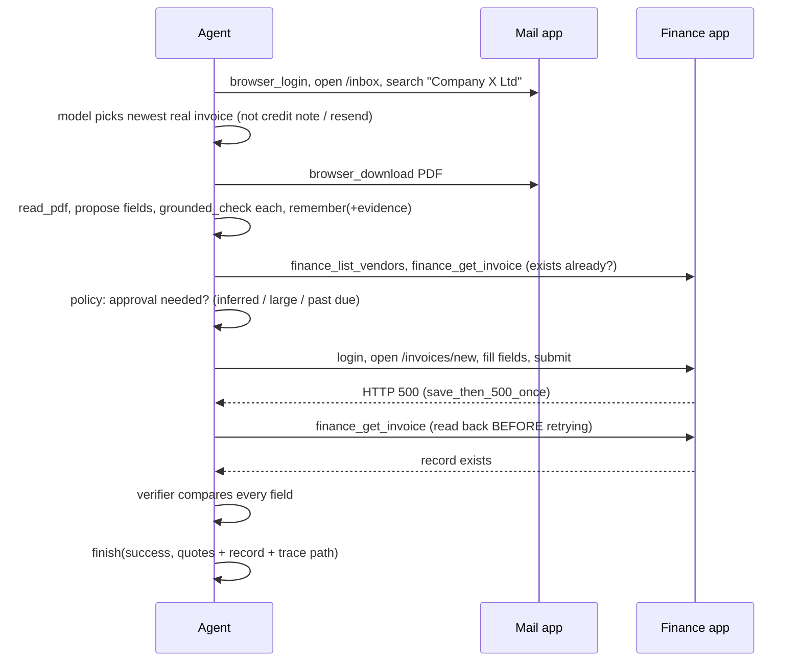

# Workflow

Model: **DeepSeek V4 Flash** (one model, two modes). Planner = reasoning on, executor/verifier = reasoning off.
V4 Flash is text-only, so the agent reads the DOM (snapshot), not screenshots. Actions are JSON validated by
pydantic; native tool-calling is not relied on (unverified).

## 1. The loop

## 2. Main task (happy path + one ambiguous failure)

## 3. Fault to recovery

| Injected fault | Seen as | Reaction |
|---|---|---|
| error500/503, blank page, dropped connection | ERR_HTTP_5XX / ERR_BLANK_PAGE / ERR_NAV_FAILED | wait, retry up to MAX_RETRIES |
| popup_banner | ERR_INTERCEPTED | click `banner-dismiss`, continue |
| session_expires_after | ERR_SESSION_EXPIRED | browser_login, resume the step |
| login_flaky_once | ERR_LOGIN_TRANSIENT | retry login |
| pdf_corrupt_once / pdf_missing_once | ERR_PDF_UNREADABLE / 404 | re-download, else ask_human |
| save_then_500_once / slow_submit_ms | error or timeout on submit | read back first; do not resubmit if record exists |
| silent_save_fail | success banner, read-back empty | verifier fails, report failure honestly |
| fail_first=/inbox:99 | repeated failures | stop, write nothing, needs_human |

## 4. Who decides what

| Decision | Made by |
|---|---|
| Which email/invoice is the right one, how to fill the form | model |
| Is the value really in the document | code (`grounded_check`) |
| Is this action allowed / needs approval | code (`policy.py`) |
| Did the step work, retry or replan | code (`checker.py`), model only for fuzzy cases |
| Did the write really land | code (`verifier.py`) via read-back |
